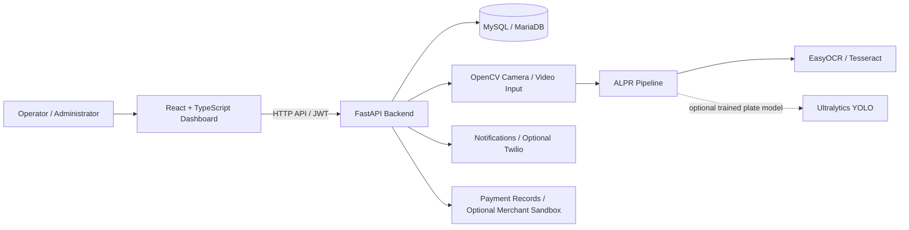

<div align="center">

# 🚗 Smart AI-Based Vehicle Parking Management System
### with Automatic License Plate Recognition (ALPR)

**A full-stack CSE project for intelligent vehicle parking operations, camera-assisted plate recognition, and parking management.**

<p>
  
  
  
  
</p>
<p>
  
  
  
  
  
</p>

**Smart Parking · ALPR · Camera Monitoring · Parking Operations · Analytics**

</div>

---

## ✨ Project at a glance

Smart AI-Based Vehicle Parking Management System is a university-level full-stack application built around a FastAPI backend, a React + TypeScript dashboard, and a MySQL/MariaDB database. It brings together vehicle records, category-aware parking allocation, entry/exit operations, configurable parking fees, payment records, camera registration, ALPR-assisted workflows, notifications, and administrative activity history.

The application also includes a responsive dashboard with **Light, Dark, and System** appearance modes. Its camera and OCR capabilities can be used with uploaded demonstration footage; real automatic plate localization depends on a compatible trained model and the required OCR language data.

> **Important:** This README distinguishes between features included in the current project, features that depend on external configuration, and interfaces that are not currently represented as dedicated routes. A feature being described here does not mean that an external camera, trained model, merchant account, or third-party service has already been configured and verified.

### 🧭 Quick navigation

| | | |
|---|---|---|
| [Features](#-core-features) | [Architecture](#-architecture) | [Windows setup](#-quick-start-windows--xampp) |
| [Docker](#-docker-compose) | [CCTV demo](#-cctv--uploaded-video-demo) | [ALPR setup](#-bangla--english-alpr) |
| [Payments](#-bkash--nagad-sandbox-integration) | [Database](#-database-setup) | [Documentation](#-project-documentation) |

---

## 🧩 Core features

<table>
  <tr>
    <td width="50%" valign="top">
      <h3>🚘 Vehicle & parking operations</h3>
      <ul>
        <li>JWT authentication and role checks</li>
        <li>Vehicle create, read, update, and delete operations</li>
        <li>Vehicle-category-aware parking slot allocation</li>
        <li>Vehicle entry and exit lifecycle</li>
        <li>Configurable fee rules, including grace period and daily cap</li>
        <li>Parking payment record creation</li>
        <li>Parking history with CSV export</li>
      </ul>
    </td>
    <td width="50%" valign="top">
      <h3>📷 Camera & ALPR workflow</h3>
      <ul>
        <li>Camera registry and camera roles</li>
        <li>Uploaded-video CCTV demonstration</li>
        <li>ALPR image upload and OCR pipeline</li>
        <li>Recognition confidence and manual-verification status</li>
        <li>Optional trained YOLO plate detector</li>
        <li>Bangla digit/plate-character normalization</li>
        <li>Operator confirmation before parking entry</li>
      </ul>
    </td>
  </tr>
  <tr>
    <td valign="top">
      <h3>📊 Dashboard & administration</h3>
      <ul>
        <li>Dashboard statistics</li>
        <li>Historical parking-demand forecast based on the previous 56 days of parking-session history</li>
        <li>Blacklist alerts and notifications</li>
        <li>Reservation notifications</li>
        <li>Administrative audit history</li>
        <li>Category-based pricing controls for authorized administrators</li>
        <li>Simulated parking-slot sensor events</li>
      </ul>
    </td>
    <td valign="top">
      <h3>💳 Payments & integrations</h3>
      <ul>
        <li>Payment record creation and demo approval/decline flow</li>
        <li>Printable payment receipts</li>
        <li>Optional bKash/Nagad merchant sandbox checkout configuration</li>
        <li>Optional Twilio reservation SMS</li>
        <li>Docker Compose support</li>
        <li>pytest-ready backend test structure</li>
      </ul>
    </td>
  </tr>
</table>

### 🎨 Frontend experience

- **Three appearance modes:** Light, Dark, and System.
- **Guest and account preferences:** guest and per-account theme preferences are stored separately in browser storage.
- **System appearance:** follows the operating-system color preference while System mode is selected.
- **Responsive navigation:** collapsible desktop sidebar and mobile navigation drawer.
- **Design language:** teal/blue theme tokens, Inter and Hind Siliguri font requests with local fallbacks, focus styles, and reduced-motion support.

For the detailed design specification and executed browser checks, see:

- [`docs/FRONTEND_DESIGN_SYSTEM.md`](docs/FRONTEND_DESIGN_SYSTEM.md)
- [`docs/FRONTEND_RESPONSIVE_VERIFICATION.md`](docs/FRONTEND_RESPONSIVE_VERIFICATION.md)

> **Route availability note:** The shared theme and responsive shell do not imply that separate dedicated pages already exist for ROI editing, camera health history, a standalone analytics page, ALPR review workbench, registration, forgot-password, or backup management. These are dependent on additional feature work. The current modules listed above describe the functionality represented in the supplied project information.

---

## 🏗️ Architecture



### Technology stack

| Layer | Technology | Responsibility |
|---|---|---|
| Frontend | React, TypeScript, Vite | Dashboard, forms, navigation, themes, and user interactions |
| Styling | Tailwind CSS and shared theme tokens | Responsive layouts and consistent Light/Dark/System appearance |
| Backend | Python, FastAPI | REST APIs, business rules, authentication, and integrations |
| Database | MySQL / MariaDB | Users, vehicles, parking operations, payments, cameras, and history |
| Authentication | JWT and role checks | Authenticated access and role-aware operations |
| Computer vision | OpenCV | Camera/video input and frame processing |
| OCR | EasyOCR and Tesseract | English OCR and Bengali/English OCR where configured |
| Plate localization | Optional trained Ultralytics YOLO model | Locating plates inside full vehicle images when compatible weights are supplied |
| Deployment | Docker Compose | Container-based development/deployment option |
| Testing | pytest-ready backend structure | Backend automated testing |

---

## 🖥️ Quick start: Windows + XAMPP

This is the local-development workflow for Windows.

### 1. Prerequisites

Install and prepare:

- Windows 10/11
- Python 3.11 or a compatible version required by the backend dependencies
- Node.js and npm
- XAMPP with MySQL/MariaDB
- Git (recommended)
- Tesseract OCR with `eng` and `ben` language data for Bengali/English OCR

### 2. Start the database

1. Open the XAMPP Control Panel.
2. Start **MySQL**.
3. Open phpMyAdmin or a MySQL/MariaDB client.
4. Run the SQL files in the correct order for a fresh installation:

```text
database/schema.sql
database/seeds.sql
```

Run the schema first, followed by the seed data.

### 3. Set up the backend

Open PowerShell in the project directory:

```powershell
cd backend
py -3.11 -m venv .venv
.\.venv\Scripts\Activate.ps1
python -m pip install --upgrade pip
pip install -r requirements.txt
```

If PowerShell blocks virtual-environment activation, use the Python environment activation method permitted by your local Windows policy, or run the environment's Python executable directly.

### 4. Configure the backend environment

Copy the example file:

```powershell
Copy-Item .env.example .env
```

Open `backend/.env` and configure the actual local database connection values and the administrator bootstrap password expected by the application, including `INITIAL_ADMIN_PASSWORD` where used by the current bootstrap flow.

**Security requirements:**

- Set a unique, strong administrator password before first startup.
- Change the initial password after first sign-in if the application requires it.
- Never commit `backend/.env`.
- Never paste real passwords, database credentials, JWT secrets, or API keys into source code or frontend variables.

### 5. Start the backend

From the `backend/` directory, with the virtual environment active:

```powershell
python main.py
```

The backend is expected to be available at:

```text
http://localhost:8000
```

### 6. Set up and start the frontend

Open a second terminal:

```powershell
cd frontend
npm install
npm run dev
```

Open the development application:

```text
http://localhost:5173
```

### 7. Sign in

Use the administrator account initialized by the project's configured bootstrap process. The initial password is supplied through the backend environment configuration; it is not a public default credential.

If login fails, verify the backend database configuration, whether the administrator account exists, the configured username/email, and the bootstrap/password-hashing flow. Do not repeatedly create new administrator accounts or reset passwords automatically.

### Useful frontend checks

Run these commands from `frontend/` when the corresponding scripts are configured in `package.json`:

```powershell
npm run lint
npm run build
```

### Backend tests

Run from `backend/` using the project's configured virtual environment:

```powershell
python -m pytest
```

The exact test coverage and any skipped integration tests should be checked in the test output. A passing SQLite/unit-test suite does not by itself prove MariaDB concurrency, real camera operation, or external payment-provider integration.

---

## 🐳 Docker Compose

The repository includes Docker Compose support. Use the root `.env.example` as the configuration template for the Compose environment.

### 1. Configure root environment variables

Copy the template:

```powershell
Copy-Item .env.example .env
```

Set distinct, strong values for at least:

- `DB_PASSWORD`
- `MYSQL_ROOT_PASSWORD`
- `SECRET_KEY` — at least 32 random characters
- `INITIAL_ADMIN_PASSWORD` — at least 12 characters

Generate a strong signing secret:

```powershell
python -c "import secrets; print(secrets.token_urlsafe(48))"
```

For network-camera credential encryption, generate a Fernet key:

```powershell
python -c "from cryptography.fernet import Fernet; print(Fernet.generate_key().decode())"
```

Configure the generated key as `CAMERA_CREDENTIALS_KEY` and set the required camera host allowlist for the cameras that the backend is authorized to access.

### 2. Build and start

From the project root:

```powershell
docker compose up --build
```

Use another terminal to inspect service status and logs:

```powershell
docker compose ps
docker compose logs
```

Stop the services with:

```powershell
docker compose down
```

> ⚠️ Do not commit the populated `.env`. Do not use destructive volume-removal commands against a database containing data you need. The application container runs outside development mode and is expected to reject weak or missing signing/admin secrets.

---

## 📷 CCTV & uploaded-video demo

The project supports a camera/video demonstration workflow using a registered camera and an uploaded clip.

### Supported uploaded-video formats

`MP4`, `AVI`, `MOV`, `MKV`, and `WebM` — maximum upload size: **100 MB**.

### Demo workflow

1. Open **Cameras** in the dashboard.
2. Add or select a registered camera.
3. Open **Video input** and upload a supported video clip.
4. The uploaded clip is stored under `backend/uploads/camera_demos/`.
5. The registered camera is switched to the Upload/Online demo state.
6. Open **CCTV Monitor** to view the server-looped MJPEG preview.
7. Select **Start plate scan** to sample the feed every four seconds and run the available ALPR pipeline.
8. Review the normalized recognition result.
9. Select **Use plate at entry** to pre-fill Vehicle Entry.
10. An operator must review and confirm the entry.

### Network and USB cameras

For CCTV/IP/RTSP sources:

- Configure a stream URL reachable from the backend host.
- Add the camera hostname, IP, or CIDR to the server-side `CAMERA_ALLOWED_HOSTS` setting as required.
- Use only cameras and feeds you own or are authorized to monitor.
- Keep credentials server-side. Camera credentials are encrypted at rest when the required key is configured.
- The camera API does not return source URLs; clients receive a `stream_configured` flag and short-lived stream tickets.

For USB cameras, configure the numeric device index.

> **Recognition limitation:** Automatic plate localization inside a full vehicle image depends on a compatible trained plate detector. Without compatible trained weights, the application can still support the available upload/manual-verification workflow, but it must not claim that automatic plate localization is active.

---

## 🔤 Bangla + English ALPR

The supplied ALPR pipeline combines:

- Optional YOLO-based plate localization.
- EasyOCR for English recognition.
- Tesseract for Bengali/English recognition when the language data is installed.
- Bengali digit and plate-character normalization into a canonical English searchable form.
- Confidence-based manual verification for uncertain OCR results.

### Example normalization

| Bengali input | Normalized output |
|---|---|
| `ঢাকা মেট্রো ল ১৭-৭৫৪৪` | `DHAKA METRO LA 17-7544` |

The example above is a normalization illustration, not a complete official Bangladeshi plate-format specification.

### Tesseract setup

On Windows, install Tesseract OCR and ensure both language packs are available:

- `eng`
- `ben`

Configure the executable path and OCR settings using the backend's environment/configuration options where required.

See [`docs/BANGLA_ENGLISH_ALPR_SETUP.md`](docs/BANGLA_ENGLISH_ALPR_SETUP.md) and [`docs/ALPR_MODEL_SETUP.md`](docs/ALPR_MODEL_SETUP.md) if present in your project version.

### Model placement

For automatic plate detection inside full vehicle images, provide a compatible trained model at:

```text
ai-models/plate_yolo.pt
```

The model must match the inference code and be evaluated on a representative held-out dataset. A generic, missing, or untrained model is not a valid substitute for a trained plate detector.

---

## 🎥 Camera management

The project provides three default demo camera endpoints:

| Camera ID | Role | Location |
|---|---|---|
| `ENTRY-01` | `ENTRY` | Main Entry Gate |
| `EXIT-01` | `EXIT` | Main Exit Gate |
| `ZONE-A` | `PARKING_ZONE` | Parking Zone A |

Authorized administrators can add, edit, and remove cameras and configure available USB, IP/RTSP, Upload, or Demo sources.

For an existing installation that needs the camera-role field, the supplied upgrade path is:

```text
database/migration_camera_roles.sql
```

Run migrations only after checking the current schema and following the project's upgrade instructions. Do not rerun one-time `ALTER TABLE` migrations without verifying whether they have already been applied.

---

## 💳 bKash & Nagad sandbox integration

The project includes a provider-backed sandbox checkout path when valid merchant sandbox credentials and callback configuration are supplied.

**This is a merchant sandbox integration—not a personal-wallet Send Money workflow.** Do not enter personal wallet PINs or OTPs into the application, and do not claim that a payment is verified just because a customer submitted a transaction reference.

### Configuration

Copy the payment-related variables from `backend/.env.example` into `backend/.env`, then add credentials issued for your merchant sandbox account.

Keep private credentials on the backend only. Never place them in frontend environment variables or commit them.

1. Set `PAYMENT_MODE=sandbox` and keep the sandbox API URLs.
2. Start the backend on port `8000`.
3. Expose the local backend temporarily through a trusted HTTPS tunnel for provider callback testing. For example, with Cloudflare Tunnel installed:

   ```powershell
   cloudflared tunnel --url http://localhost:8000
   ```

4. Keep the tunnel terminal running during the test.
5. Set `PAYMENT_CALLBACK_BASE_URL` to the generated HTTPS host followed by `/api/v1/payments`.
6. Set `PAYMENT_RETURN_URL` to the frontend payment-result route.
7. Configure the merchant-issued credentials:

   **bKash sandbox**
   - Sandbox username
   - Sandbox password
   - App key
   - App secret

   **Nagad sandbox**
   - Merchant ID/number
   - Fixed server egress IPv4, if required by the issued integration
   - Nagad public key
   - Merchant private key

8. Preserve PEM line breaks or encode them as `\n` according to the backend configuration requirements.
9. Restart the backend after changing `.env`.
10. Sign in and check `/api/v1/payments/config`. Each provider's `configured` value should be `true` before its checkout option is available.
11. Open **Payments** or **Vehicle Exit**, choose a provider, and use only the sandbox test account/data from the merchant-issued guide.

The backend verifies the transaction with the provider and checks the verified amount/currency before issuing a receipt.

### Payment safety

- Use a temporary test database for tunnel-based testing.
- Change default credentials and the signing secret before exposing the development API.
- Share the tunnel URL only with the provider/tester who needs it.
- Stop the tunnel immediately after testing.
- Never use real customer data or live-money credentials in a sandbox test.
- Confirm Nagad request/signature fields and callback parameters against the current merchant-issued integration guide before treating checkout as verified.
- Do not switch to live API URLs or live payment mode without provider approval and a public HTTPS callback.

> ⚠️ A temporary HTTPS tunnel exposes your development API to the internet. Treat it as a controlled test-only configuration.

---

## 📩 Optional reservation SMS with Twilio

Reservation confirmation SMS is optional. Without Twilio credentials, reservation creation can still succeed and the application reports that SMS is disabled.

### Configuration

1. Configure a Twilio account and obtain an Account SID, Auth Token, and SMS-capable sender number.
2. Set these values in `backend/.env`:

   ```dotenv
   TWILIO_SMS_ENABLED=true
   TWILIO_ACCOUNT_SID=your_account_sid
   TWILIO_AUTH_TOKEN=your_auth_token
   TWILIO_FROM_NUMBER=your_twilio_sender_number
   ```

3. Restart the backend.
4. Enter the customer's mobile number when creating a reservation.

Bangladesh numbers in `01XXXXXXXXX` format and Bengali-digit numbers are normalized to `+8801XXXXXXXXX`. International E.164 numbers are also accepted.

The API reports `queued` when Twilio accepts the SMS request. **Queued does not mean delivered.** Trial accounts may only send to phone numbers verified with Twilio. If sending fails, the reservation remains valid and the operator receives a warning notification.

Keep Twilio credentials server-side. Avoid using real customer numbers in development.

---

## 🅿️ Parking, sensor simulation & notifications

### Parking demand forecast

The dashboard estimates hourly parking occupancy from parking sessions recorded over the previous **56 days**. Forecasts become more representative as more parking history is collected.

### Sensor simulator

Admin, Super Admin, or Operator users can simulate free/occupied sensor events on eligible slots. Simulated sensor events are recorded separately; they do not create fake vehicle parking records.

### Notifications

The Notifications page can show events such as:

- Reservation confirmations.
- Parking start/end.
- Payment due and payment outcome.
- Simulated sensor events.
- Blacklist alerts.

### Audit history and pricing

Admin/Super Admin users can review administrative activity and change category pricing in Settings. The supplied project information identifies audit history for fee, vehicle, camera, reservation, payment, and simulated sensor changes.

Existing databases create the new `sensor_events` table automatically at backend startup. Fresh database installations also include it in `database/schema.sql`.

---

## 🗄️ Database setup

### Fresh installation

Run the SQL files in this order:

```text
1. database/schema.sql
2. database/seeds.sql
```

### Existing database from an older project ZIP

The supplied upgrade path is:

```text
database/migration_full_upgrade.sql
```

This migration is intended as a **one-time** upgrade from the previous schema. Do not repeatedly run the same `ALTER TABLE` migration. Back up the database and inspect the current schema before applying any migration.

For existing installations, the `sensor_events` table is also created automatically at backend startup according to the supplied project notes; fresh installations include it in the schema file.

### Backup and restore reminder

Creating a backup file is not the same as proving that it can be restored. Before relying on a backup, restore it into a separate disposable test database and verify the tables and important records. Never test restoration by overwriting the working database.

---

## 🔐 Security checklist

- [ ] Keep `backend/.env` and the root `.env` out of version control.
- [ ] Use unique, strong database and administrator passwords.
- [ ] Use a signing secret of at least 32 random characters for the Docker configuration described above.
- [ ] Generate and configure `CAMERA_CREDENTIALS_KEY` before storing network-camera credentials.
- [ ] Configure `CAMERA_ALLOWED_HOSTS` for authorized camera sources.
- [ ] Keep payment and Twilio credentials server-side.
- [ ] Do not expose camera credentials or raw credential-bearing stream URLs to the frontend.
- [ ] Use only cameras you own or are authorized to monitor.
- [ ] Use payment sandbox credentials and sandbox URLs during development.
- [ ] Keep temporary HTTPS tunnels open only for the required test window.
- [ ] Do not use real customer information in development fixtures.
- [ ] Verify backup restoration in a separate disposable database.

---

## 🧪 Testing and verification

The project includes a pytest-ready backend test structure. Run the suite from the backend virtual environment:

```powershell
cd backend
python -m pytest
```

For the frontend, run the scripts configured in `frontend/package.json`, including:

```powershell
cd frontend
npm run lint
npm run build
```

### What these checks do—and do not—prove

| Check | What it verifies | What it does not prove by itself |
|---|---|---|
| Backend unit/API tests | Tested backend behavior in the test environment | Real MariaDB race behavior unless tests use MariaDB |
| Frontend lint | Static code/style checks | Runtime correctness of every page |
| Frontend build | Production bundle compiles | Real API integration or camera connectivity |
| Mocked browser tests | UI behavior for the mocked responses and viewports tested | Correctness with live database records |
| Uploaded-video demo | CCTV preview and available ALPR workflow for the clip | Accuracy on every real CCTV feed |
| OCR setup check | OCR engine/language availability | Recognition accuracy on representative real footage |

For a release, separately verify database migrations, backup restoration, MariaDB concurrency, real camera connections, trained model inference, and sandbox payment callbacks where those dependencies are available.

---

## 🧰 Troubleshooting

<details>
<summary><strong>Backend cannot connect to MySQL/MariaDB</strong></summary>

- Confirm MySQL is running in XAMPP.
- Verify the host, port, database name, username, and password in `backend/.env`.
- Confirm that the schema and seed SQL have been applied in the correct order.
- Check whether another MySQL/MariaDB service is using the configured port.
- Restart the backend after environment changes.

</details>

<details>
<summary><strong>Admin login returns “Incorrect username or password”</strong></summary>

- Confirm that the backend is connected to the intended database.
- Check whether the administrator account was created by the configured bootstrap process.
- Verify the configured username/email and current password against the account setup procedure.
- Confirm that password creation and verification use the same hashing implementation.
- Do not create duplicate administrator accounts or expose the password in logs.
- Use the project's secure administrator setup/reset process if the account needs repair.

</details>

<details>
<summary><strong>Frontend cannot reach the backend</strong></summary>

- Confirm that the backend is running at `http://localhost:8000`.
- Confirm the frontend API base URL matches the backend address.
- Inspect browser developer tools for network errors and CORS responses.
- Verify that the requested API route exists and that the logged-in role has permission.

</details>

<details>
<summary><strong>CCTV feed is offline or cannot open</strong></summary>

- Confirm the source is reachable from the backend host, not only from the user's browser.
- For IP/RTSP feeds, check the camera URL, credentials, hostname/IP allowlist, and network route.
- For USB cameras, check the numeric device index and whether another application is using the device.
- Confirm the source is supported by the installed OpenCV/video backend.
- Review backend camera errors without publishing source credentials.

</details>

<details>
<summary><strong>ALPR does not localize a plate in a full vehicle image</strong></summary>

- Confirm that a compatible trained plate detector is present at the configured model path, such as `ai-models/plate_yolo.pt`.
- Confirm that the model is compatible with the inference implementation.
- Install Tesseract with both `eng` and `ben` language data for English and Bengali OCR.
- Review image quality, plate size, blur, lighting, and camera angle.
- Use manual verification for low-confidence results.
- Do not treat a missing or generic model as a trained detector.

</details>

<details>
<summary><strong>bKash/Nagad checkout is not available</strong></summary>

- Confirm that `PAYMENT_MODE=sandbox` is configured for sandbox testing.
- Verify all merchant-issued credentials are configured server-side.
- Check `/api/v1/payments/config` and confirm the relevant provider reports `configured: true`.
- Confirm that the callback uses a public HTTPS URL reachable by the provider.
- Check the merchant-issued integration guide, especially Nagad signature/request requirements.
- Restart the backend after changing `.env`.

</details>

<details>
<summary><strong>Twilio SMS is not sent</strong></summary>

- Confirm `TWILIO_SMS_ENABLED=true`.
- Verify the Account SID, Auth Token, and sender number.
- Check whether a Twilio trial account requires the recipient number to be verified.
- Remember that `queued` means accepted by Twilio, not delivered.

</details>

---

## 📚 Project documentation

Open the following project documents for more detail. Some documents are optional references depending on the project version; use the files present in your checkout.

| Document | Purpose |
|---|---|
| [`docs/WINDOWS_RUNBOOK.md`](docs/WINDOWS_RUNBOOK.md) | Windows development runbook |
| [`docs/INSTALLATION.md`](docs/INSTALLATION.md) | Installation instructions |
| [`docs/USER_MANUAL.md`](docs/USER_MANUAL.md) | User-facing application guide |
| [`docs/ALPR_MODEL_SETUP.md`](docs/ALPR_MODEL_SETUP.md) | ALPR model configuration |
| [`docs/BANGLA_ENGLISH_ALPR_SETUP.md`](docs/BANGLA_ENGLISH_ALPR_SETUP.md) | Bengali/English OCR setup |
| [`docs/FRONTEND_DESIGN_SYSTEM.md`](docs/FRONTEND_DESIGN_SYSTEM.md) | Theme tokens and frontend design system |
| [`docs/FRONTEND_RESPONSIVE_VERIFICATION.md`](docs/FRONTEND_RESPONSIVE_VERIFICATION.md) | Responsive checks and known limitations |

---

## 🗂️ Repository layout

The following is a high-level map of the project paths referenced by the setup and feature documentation. Individual files may vary by project revision.

```text
smart-parking/
├── backend/
│   ├── app/                  # FastAPI application modules
│   ├── uploads/              # Uploaded demonstration media (keep private)
│   ├── requirements.txt
│   ├── .env.example
│   └── main.py
├── frontend/
│   ├── src/                  # React + TypeScript application
│   ├── package.json
│   └── ...
├── database/
│   ├── schema.sql
│   ├── seeds.sql
│   ├── migration_full_upgrade.sql
│   └── migration_camera_roles.sql
├── docs/
│   ├── WINDOWS_RUNBOOK.md
│   ├── INSTALLATION.md
│   ├── USER_MANUAL.md
│   ├── ALPR_MODEL_SETUP.md
│   ├── BANGLA_ENGLISH_ALPR_SETUP.md
│   ├── FRONTEND_DESIGN_SYSTEM.md
│   └── FRONTEND_RESPONSIVE_VERIFICATION.md
├── ai-models/                # Place compatible trained model weights here
├── .env.example              # Docker Compose configuration template
└── README.md
```

> The tree is an orientation aid, not a guarantee that every optional directory or document exists in every archive revision.

---

## 🛣️ Current capabilities and dependencies

| Capability | Current project description | Dependency / limitation |
|---|---|---|
| JWT authentication | Authentication and role checks are included | Initial administrator must be initialized securely |
| Parking allocation | Category-aware slot allocation | Depends on configured categories and available slots |
| Entry/exit | Parking entry/exit lifecycle | Operator review is required for uncertain ALPR results |
| Fee calculation | Grace period and daily cap are configurable | Depends on the configured pricing rules |
| ALPR upload/OCR | Upload/OCR pipeline and confidence/manual-review status | OCR engine and language data must be installed |
| Automatic plate localization | Optional YOLO plate detector | Compatible trained weights required |
| CCTV demo | Uploaded video can be looped as MJPEG preview | Supported clip, backend access, and camera configuration required |
| Demand forecast | Uses the previous 56 days of parking-session history | More history improves representativeness |
| SMS | Optional Twilio reservation notification | Twilio account and server-side credentials required |
| Merchant checkout | bKash/Nagad sandbox configuration | Merchant-issued sandbox credentials and public HTTPS callback required |
| Sensor simulation | Simulated available/occupied sensor events | Simulation is not a real physical sensor installation |
| Docker | Docker Compose support | Docker Engine/Desktop and valid environment configuration required |

---

## 🤝 Development notes

- Keep feature logic in the appropriate backend service rather than embedding business rules in frontend components.
- Keep API credentials, database passwords, camera credentials, and signing secrets server-side.
- Preserve manual operator confirmation for uncertain ALPR results.
- Treat uploaded footage and camera feeds as sensitive operational data.
- Keep simulated sensor states distinguishable from actual parking transactions.
- Validate migrations against a backup or disposable database before applying them to valuable data.
- Document any new API routes, environment variables, and migrations as the project evolves.

## 📄 License and academic use

No license terms were specified in the supplied project information. Add a `LICENSE` file and update this section only after the project owner selects the license and confirms that included dependencies, fonts, models, and other assets permit the intended redistribution.

---

<div align="center">

### 🚦 Smart Parking — Making Parking Operations Smarter

**FastAPI · React · TypeScript · MySQL · OpenCV · ALPR**

<sub>Built as a university-level Computer Science & Engineering project.</sub>

</div>
