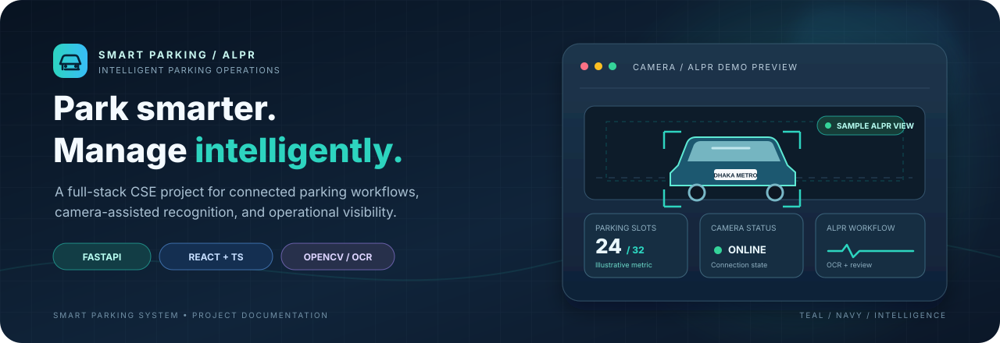
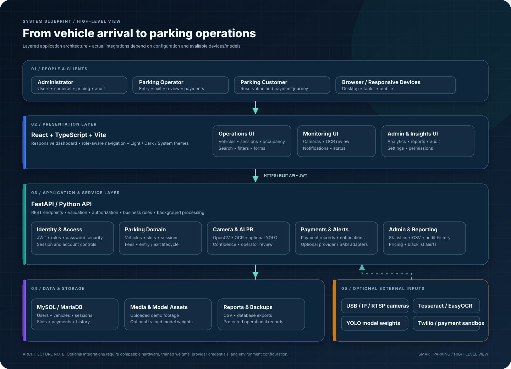
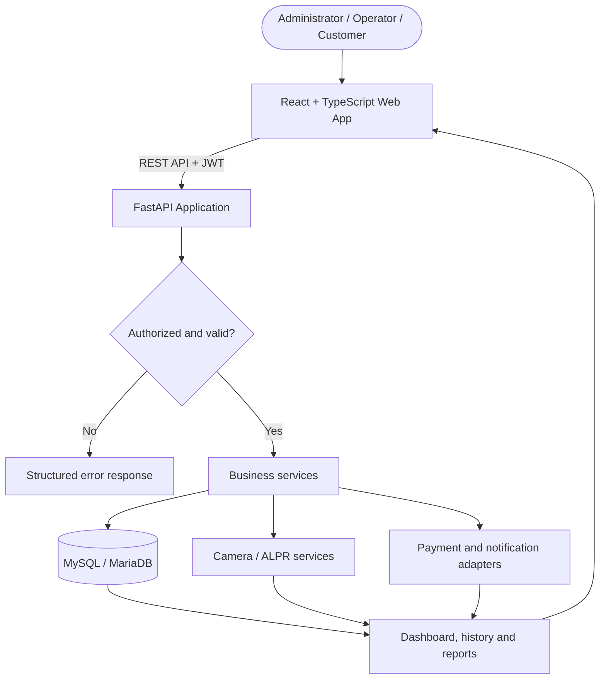
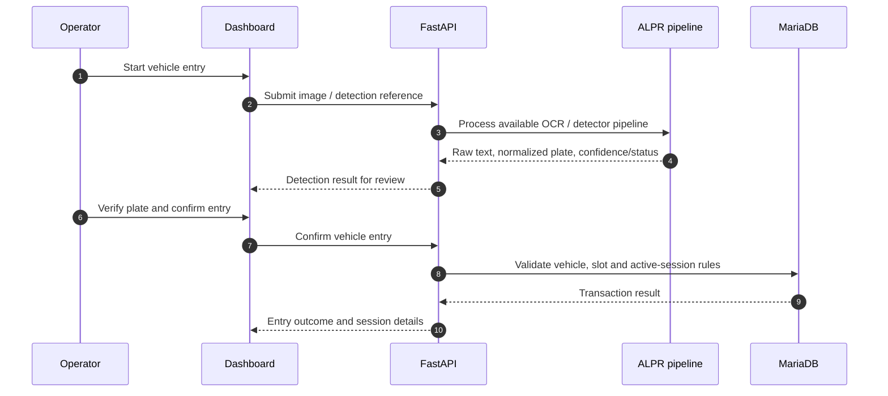
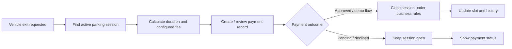

<div align="center">



<br /> 

[](https://fastapi.tiangolo.com/)
[](https://react.dev/)
[](https://www.typescriptlang.org/)
[](https://mariadb.org/)
[](https://opencv.org/)


### **Park smarter. Manage intelligently.**

A university-level full-stack CSE project bringing together parking operations, camera-assisted plate recognition, and an operations-focused web dashboard.

[Explore Features](#-what-the-system-brings-together) · [Architecture](#-architecture-at-a-glance) · [Install](#-get-started) · [Camera & ALPR](#-camera--alpr-workflow) · [Documentation](#-documentation-map)

</div>

---

## ✦ The project in one view

<table>
<tr>
<td width="33%" valign="top">
<h3>🚘 Parking operations</h3>
Vehicle records, category-aware slot allocation, entry/exit lifecycle, fee rules, payment records, and parking history.
</td>
<td width="33%" valign="top">
<h3>📷 Camera-assisted ALPR</h3>
Camera registry, uploaded-video CCTV demo, OCR pipeline, confidence-aware review, and Bangla-to-English plate normalization.
</td>
<td width="33%" valign="top">
<h3>📊 Operational visibility</h3>
Dashboard statistics, demand forecasting, blacklist alerts, notifications, audit history, and responsive administration UI.
</td>
</tr>
</table>

> [!IMPORTANT]
> This README documents the capabilities and setup described by the supplied project. Hardware, model weights, OCR language packs, merchant credentials, and third-party services must be configured separately. A setup interface or optional integration does **not** mean that the external service has already been configured or verified.

## 🧭 Navigation

<details open>
<summary><strong>Open the project guide</strong></summary>

| Start here | Build & understand | Operate & verify |
|---|---|---|
| [Project overview](#-the-project-in-one-view) | [Architecture](#-architecture-at-a-glance) | [CCTV demo](#-camera--alpr-workflow) |
| [Feature map](#-what-the-system-brings-together) | [Technology stack](#-technology-stack) | [bKash/Nagad sandbox](#-bkash--nagad-merchant-sandbox) |
| [Windows setup](#-get-started) | [Repository layout](#-repository-map) | [Database](#-database-setup) |
| [Docker](#-docker-compose) | [Frontend themes](#-frontend-experience) | [Testing](#-quality-checks) |
| [Troubleshooting](#-troubleshooting) | [Project docs](#-documentation-map) | [Security](#-security-basics) |

</details>

---

# 🧩 What the system brings together

The application combines a React + TypeScript dashboard with a FastAPI backend and a MySQL/MariaDB database. Its modules are organized around the real parking workflow: register a vehicle, allocate a compatible slot, record entry and exit, calculate fees, create payment records, and retain operational history.

<table>
<thead>
<tr><th width="25%">Domain</th><th>Included capability</th><th width="25%">Important dependency / note</th></tr>
</thead>
<tbody>
<tr>
<td><strong>🚘 Vehicle operations</strong></td>
<td>Vehicle CRUD, category-aware parking slot allocation, entry/exit lifecycle, parking history.</td>
<td>Depends on configured vehicle categories and slot inventory.</td>
</tr>
<tr>
<td><strong>🅿️ Parking & pricing</strong></td>
<td>Configurable fee rules with grace period and daily cap; parking payment record creation.</td>
<td>Fee results depend on the active pricing configuration.</td>
</tr>
<tr>
<td><strong>📷 Camera registry</strong></td>
<td>Camera registry with ENTRY, EXIT, and PARKING_ZONE roles; USB/IP/RTSP/Upload/Demo sources where configured.</td>
<td>Physical feeds must be reachable from the backend host and authorized.</td>
</tr>
<tr>
<td><strong>🔤 ALPR workflow</strong></td>
<td>Image upload/OCR pipeline, confidence and manual-verification status, Bangla digit/character normalization.</td>
<td>Automatic plate localization requires compatible trained detector weights.</td>
</tr>
<tr>
<td><strong>🧠 AI detection</strong></td>
<td>Optional YOLO plate-localization integration.</td>
<td>A compatible trained model is not implied by the source code or model path.</td>
</tr>
<tr>
<td><strong>📊 Dashboard</strong></td>
<td>Dashboard statistics and historical parking-demand forecast.</td>
<td>Forecast uses parking-session history from the previous 56 days; representativeness improves as records grow.</td>
</tr>
<tr>
<td><strong>🔔 Notifications</strong></td>
<td>Reservation notifications, blacklist alerts, parking/payment-related notifications, and optional Twilio reservation SMS.</td>
<td>Twilio delivery requires server-side credentials; `queued` is not a delivery receipt.</td>
</tr>
<tr>
<td><strong>🛡️ Administration</strong></td>
<td>JWT authentication, role checks, administrative audit history, category-pricing controls.</td>
<td>Initialize and protect the administrator account using the configured bootstrap flow.</td>
</tr>
<tr>
<td><strong>🧪 Simulation</strong></td>
<td>Parking-slot sensor-event simulator and demo payment approval/decline flow with printable receipts.</td>
<td>Simulated sensor events are not real physical sensor readings. Demo payment is not a merchant transaction.</td>
</tr>
<tr>
<td><strong>🐳 Deployment</strong></td>
<td>Docker Compose support and pytest-ready backend test structure.</td>
<td>Runtime verification depends on Docker, database configuration, and environment secrets.</td>
</tr>
</tbody>
</table>

## 🎨 Frontend experience

<div align="center">

| ☀️ Light | 🌙 Dark | 🖥️ System |
|:---:|:---:|:---:|
| Bright, low-noise surfaces | Deep navy surfaces | Follows operating-system preference |
| Teal primary actions | Teal/cyan accents | Updates when OS theme changes |
| Clear data hierarchy | Comfortable contrast | Guest and account preference handling |

</div>

The responsive frontend uses a collapsible desktop sidebar and mobile navigation drawer. The shared visual language uses teal/blue theme tokens, **Inter** and **Hind Siliguri** font requests with local fallbacks, visible focus styles, and reduced-motion support.

Design references:

- [`docs/FRONTEND_DESIGN_SYSTEM.md`](docs/FRONTEND_DESIGN_SYSTEM.md)
- [`docs/FRONTEND_RESPONSIVE_VERIFICATION.md`](docs/FRONTEND_RESPONSIVE_VERIFICATION.md)

> **Route boundary:** The supplied project notes do not establish dedicated routes for a parking ROI editor, persistent camera-health history page, standalone analytics page, ALPR review workbench, registration, forgot-password, or backup-management. The shared responsive shell does not mean those pages already exist. Check the actual checkout before relying on optional routes.

---

# 🏗️ Architecture at a glance

<div align="center">


<sub>High-level architecture illustration. Optional integrations are configuration-dependent.</sub>
</div>

### Architecture layers

| Layer | Main responsibility | Technology / components |
|---|---|---|
| **01 · Client** | Admin, operator, and customer interactions | Browser, responsive UI |
| **02 · Presentation** | Routes, dashboard, forms, theme, role-aware navigation | React, TypeScript, Vite, Tailwind CSS |
| **03 · Application** | Authentication, parking rules, camera/OCR pipeline, payments, notifications | FastAPI, Python, OpenCV, OCR adapters |
| **04 · Data** | Users, vehicles, sessions, slots, payments, events, history | MySQL / MariaDB |
| **05 · External inputs** | Physical cameras, trained weights, OCR language data, optional messaging/payment providers | USB/IP/RTSP, YOLO, Tesseract, EasyOCR, Twilio, merchant sandbox |

### Core request path



### Vehicle entry: operational flow



> The sequence describes the operator-confirmed ALPR-assisted workflow. It does not imply unattended gate automation or a guaranteed recognition result.

### Exit and payment: operational flow



---

# ⚙️ Technology stack

<div align="center">

| Frontend | Backend | Data & vision |
|:---:|:---:|:---:|
| React | Python 3.11+ | MySQL / MariaDB |
| TypeScript | FastAPI | OpenCV |
| Vite | Pydantic | EasyOCR |
| Tailwind CSS | SQLAlchemy | Tesseract OCR |
| Recharts / existing chart layer | JWT / role checks | Optional Ultralytics YOLO |

</div>

| Area | Technology | Purpose |
|---|---|---|
| Frontend | React + TypeScript + Vite | Responsive dashboard and interactions |
| Styling | Tailwind CSS + shared tokens | Layout, typography, and theme-aware components |
| Backend | Python + FastAPI | REST APIs, validation, authentication, and business rules |
| Persistence | SQLAlchemy + MySQL/MariaDB | Application data and relational records |
| Authentication | JWT + role checks | Protected endpoints and permission-aware UI |
| Computer vision | OpenCV | Camera/video input and frame processing |
| OCR | EasyOCR + Tesseract | English and Bengali/English OCR according to installed support |
| Plate localization | Optional trained YOLO model | Locate a plate inside a full vehicle image when compatible weights are supplied |
| Messaging | Optional Twilio | Reservation SMS when configured |
| Payment | Optional bKash/Nagad merchant sandbox | Provider-backed checkout with merchant credentials |
| Deployment | Docker Compose | Container-based environment |
| Testing | pytest | Backend test structure |

---

# 🚀 Get started

Choose the environment you want to run. The Windows/XAMPP route is the local development path; Docker Compose is an alternative container workflow.

<details open>
<summary><strong>🪟 Option A — Windows + XAMPP</strong></summary>

### Prerequisites

- Windows 10/11.
- Python 3.11+ (or the version supported by the backend dependency set).
- Node.js and npm.
- XAMPP with MySQL/MariaDB.
- Git (recommended).
- Tesseract OCR with `eng` and `ben` language data for Bengali/English OCR.

### 1 · Start the database

1. Open XAMPP Control Panel.
2. Start **MySQL**.
3. Open phpMyAdmin or a MySQL/MariaDB client.
4. For a fresh installation, execute the schema and seed files in order:

```text
database/schema.sql
database/seeds.sql
```

### 2 · Prepare the backend

Open PowerShell at the project root:

```powershell
cd backend
py -3.11 -m venv .venv
.\.venv\Scripts\Activate.ps1
python -m pip install --upgrade pip
pip install -r requirements.txt
```

If PowerShell blocks activation, follow your Windows execution policy or invoke the virtual environment's Python executable directly.

### 3 · Configure environment

```powershell
Copy-Item .env.example .env
```

Edit `backend/.env` with the database connection values expected by the current backend settings. Prefer the secure local administrator command below instead of storing an initial password in the environment file.

**Security checklist before startup:**

- Initialize the administrator with hidden terminal password entry.
- Use a strong application signing secret where required.
- Never commit `backend/.env`.
- Never place database credentials, JWT secrets, camera passwords, or payment keys in frontend variables.
- The first administrator sign-in requires password rotation.

### 4 · Start the backend

From `backend/`, with the virtual environment active:

```powershell
python main.py
```

Expected local API address:

```text
http://localhost:8000
```

### 5 · Start the frontend

Open a second terminal:

```powershell
cd frontend
npm install
npm run dev
```

Open:

```text
http://localhost:5173
```

### 6 · Sign in

Use the administrator account created by the configured bootstrap process. There is no safe public default password in this documentation.

If login fails, check the database target, whether the admin account exists, the configured username, password hashing compatibility, and the actual bootstrap flow. Do not repeatedly create administrator accounts or overwrite existing credentials automatically.

### 7 · Run local checks

Frontend:

```powershell
cd frontend
npm run lint
npm run build
```

Backend:

```powershell
cd backend
python -m pytest
```

> A passing build or unit-test suite does not prove real camera connectivity, trained-model accuracy, MariaDB race safety, or payment-provider callbacks. Verify those separately.

</details>

<details>
<summary><strong>🐳 Option B — Docker Compose</strong></summary>

The repository includes Docker Compose support. Use the root `.env.example` as a template.

### 1 · Configure root environment

```powershell
Copy-Item .env.example .env
```

Set unique values for at least:

- `DB_PASSWORD`
- `MYSQL_ROOT_PASSWORD`
- `SECRET_KEY` — at least 32 random characters
- `INITIAL_ADMIN_PASSWORD` — at least 12 characters

Generate a signing secret:

```powershell
python -c "import secrets; print(secrets.token_urlsafe(48))"
```

For network-camera credential encryption, generate a Fernet key:

```powershell
python -c "from cryptography.fernet import Fernet; print(Fernet.generate_key().decode())"
```

Configure it as `CAMERA_CREDENTIALS_KEY` and set the camera host allowlist required by the backend.

### 2 · Validate and start

```powershell
docker compose config
docker compose up --build
```

Inspect service status and logs:

```powershell
docker compose ps
docker compose logs
```

Stop services:

```powershell
docker compose down
```

> [!CAUTION]
> Do not commit the populated `.env`. Do not use destructive volume-removal commands against a database containing data you need. Compose startup is verified only when the configured Docker environment has actually been built and run.

</details>

---

# 📷 Camera & ALPR workflow

## CCTV and uploaded-video demo

The project describes an uploaded-video demonstration workflow using a registered camera.

**Supported clip formats:** MP4, AVI, MOV, MKV, WebM. **Maximum upload size:** 100 MB.

```mermaid
flowchart LR
    A[Register / select camera] --> B[Upload supported video]
    B --> C[Server-looped MJPEG preview]
    C --> D[Start plate scan]
    D --> E[Sample frames every 4 seconds]
    E --> F[Available ALPR pipeline]
    F --> G[Review normalized result]
    G --> H[Use plate at Vehicle Entry]
    H --> I[Operator verifies and confirms]
```



### Demo steps

1. Open **Cameras** in the dashboard.
2. Add or select a registered camera.
3. Open **Video input** and upload a supported video clip.
4. The clip is stored under `backend/uploads/camera_demos/`.
5. The registered camera is switched to the Upload/Online demo state.
6. Open **CCTV Monitor** to view the server-looped MJPEG preview.
7. Select **Start plate scan** to sample the feed every four seconds and run the available ALPR pipeline.
8. Review the normalized recognition result.
9. Select **Use plate at entry** to pre-fill Vehicle Entry.
10. An operator must review and confirm the entry.

## USB / IP / RTSP cameras

For network cameras:

- Configure a stream URL reachable from the backend host.
- Add the authorized hostname, IP, or CIDR to server-side `CAMERA_ALLOWED_HOSTS` as required.
- Keep network-camera credentials server-side.
- Configure `CAMERA_CREDENTIALS_KEY` to encrypt stored credentials.
- Use only camera feeds you own or are authorized to monitor.

For USB cameras, configure the numeric device index.

The camera API is documented as returning a `stream_configured` flag and short-lived stream tickets rather than source URLs containing credentials.

> [!WARNING]
> A browser being able to reach a camera does not mean the backend host can reach it. Camera sources are opened by the backend, so test the route from the machine/container running FastAPI.

## Bangla + English ALPR

The supplied ALPR workflow combines:

- Optional YOLO plate localization.
- EasyOCR for English recognition.
- Tesseract for Bengali/English recognition when both language data and executable are configured.
- Bengali digit and plate-character normalization into a canonical English searchable form.
- Confidence-based manual verification for uncertain OCR results.

### Example normalization

| Bengali input | Normalized form |
|---|---|
| `ঢাকা মেট্রো ল ১৭-৭৫৪৪` | `DHAKA METRO LA 17-7544` |
| `ঢাকা মেট্রো গ ১২-৩৪৫৬` | `DHAKA METRO GA 12-3456` |
| `ঢাকা মেট্রো ক ১১-১২৩৪` | `DHAKA METRO KA 11-1234` |

These are normalization examples, not a complete official Bangladeshi plate-format specification.

### OCR setup

For Bengali OCR on Windows, install Tesseract OCR with both language packs:

- `eng`
- `ben`

Configure the executable path and OCR settings using the backend's supported configuration. EasyOCR is used for supported languages such as English; do not assume a Bengali model is installed in EasyOCR.

### Optional trained plate detector

For automatic plate localization inside full vehicle images, supply a compatible trained model at the configured path, such as:

```text
ai-models/plate_yolo.pt
```

The model must match the inference implementation and should be evaluated on a representative held-out dataset. A missing, generic, or untrained model is not a valid substitute for a trained plate detector.

See [`docs/ALPR_MODEL_SETUP.md`](docs/ALPR_MODEL_SETUP.md) and [`docs/BANGLA_ENGLISH_ALPR_SETUP.md`](docs/BANGLA_ENGLISH_ALPR_SETUP.md) when those documents are present in the checkout.

---

# 💳 bKash & Nagad merchant sandbox

The supplied project describes an optional **merchant sandbox checkout** integration. This is not the same as a personal-wallet Send Money workflow.

### Configuration outline

1. Copy the payment-related variables from `backend/.env.example` into `backend/.env`.
2. Set `PAYMENT_MODE=sandbox` and retain the sandbox API URLs.
3. Start the backend on port `8000`.
4. For provider callback testing, expose the local API temporarily through a trusted HTTPS tunnel. Example, with Cloudflare Tunnel installed:

   ```powershell
   cloudflared tunnel --url http://localhost:8000
   ```

5. Keep the tunnel running during the test.
6. Set `PAYMENT_CALLBACK_BASE_URL` to the generated HTTPS hostname followed by `/api/v1/payments`, without a trailing slash.
7. Set `PAYMENT_RETURN_URL` to the frontend payment-result route.
8. Configure credentials issued for the merchant sandbox account.

**bKash sandbox credentials described by the project:**

- Sandbox username.
- Sandbox password.
- App key.
- App secret.

**Nagad sandbox configuration described by the project:**

- Merchant ID/number.
- Fixed server egress IPv4 if required by the issued integration.
- Nagad public key.
- Merchant private key.

9. Restart the backend after changing `.env`.
10. Check `/api/v1/payments/config`; the provider's `configured` value should be `true` before checkout is offered.
11. Use only merchant-issued sandbox accounts and test data.

### Payment safety

- The backend must verify the transaction with the provider and match the verified amount/currency before issuing a receipt.
- Keep credentials on the backend only.
- Do not request wallet PINs or OTPs.
- Do not use real customer data or live-money credentials in sandbox testing.
- Never treat a submitted transaction reference alone as proof of payment.
- Confirm Nagad request/signature/callback requirements against the current merchant-issued guide.
- Do not switch to live endpoints without provider approval and a public HTTPS callback.

> [!CAUTION]
> A temporary HTTPS tunnel exposes the development API to the internet. Use a disposable test database, strong secrets, and stop the tunnel as soon as testing is complete.

---

# 📩 Optional reservation SMS — Twilio

Without Twilio credentials, reservation creation can still succeed and the application reports that SMS is disabled.

Configure the following server-side variables in `backend/.env`:

```dotenv
TWILIO_SMS_ENABLED=true
TWILIO_ACCOUNT_SID=your_account_sid
TWILIO_AUTH_TOKEN=your_auth_token
TWILIO_FROM_NUMBER=your_twilio_sender_number
```

Restart the backend after updating environment values.

Bangladesh `01XXXXXXXXX` numbers and Bengali-digit numbers are normalized to `+8801XXXXXXXXX`; international E.164 numbers are also accepted.

> `queued` means Twilio accepted the request. It is **not** a delivery receipt. Trial accounts may only send to destination numbers verified with Twilio.

---

# 🅿️ Parking operations, forecast & notifications

### Parking demand forecast

The dashboard estimates hourly occupancy using parking sessions from the previous **56 days**. Forecast representativeness improves as the amount and quality of historical data grow.

### Sensor simulator

Admin, Super Admin, or Operator roles can simulate free/occupied events for eligible slots. Simulated events are recorded separately and do not create fake vehicle parking records.

### Notifications

The Notifications page can display events such as:

- Reservation confirmations.
- Parking start/end.
- Payment due and payment outcome.
- Simulated sensor events.
- Blacklist alerts.

### Audit history and pricing

Admin/Super Admin users can review administrative activity and change category pricing in Settings. The project notes identify audit history for fee, vehicle, camera, reservation, payment, and simulated sensor changes.

---

# 🗄️ Database setup & migrations

## Fresh installation

Run in order:

```text
1. database/schema.sql
2. database/seeds.sql
```

## Existing installation from an older project ZIP

The supplied upgrade path is:

```text
database/migration_full_upgrade.sql
```

This migration is intended as a **one-time** upgrade from the previous schema. Back up the database and inspect the current schema before applying it. Do not repeatedly run the same `ALTER TABLE` migration.

The supplied project notes also state that existing databases create the `sensor_events` table automatically at backend startup, while fresh installations include it in `database/schema.sql`.

> [!CAUTION]
> Do not test restore by overwriting your working database. Restore a backup into a separate disposable database, verify tables and important records, and only then treat the backup as usable.

---

# 🛡️ Security basics

- [ ] Keep `backend/.env` and root `.env` out of version control.
- [ ] Use unique, strong database and administrator passwords.
- [ ] Configure a strong application signing secret (the Docker notes specify at least 32 random characters).
- [ ] Generate and configure `CAMERA_CREDENTIALS_KEY` before storing network-camera credentials.
- [ ] Configure `CAMERA_ALLOWED_HOSTS` for authorized camera sources.
- [ ] Keep payment and Twilio credentials server-side.
- [ ] Do not expose camera credentials or raw credential-bearing stream URLs to the frontend.
- [ ] Use only cameras you own or are authorized to monitor.
- [ ] Use payment sandbox credentials and sandbox URLs during development.
- [ ] Keep temporary HTTPS tunnels open only for the required test window.
- [ ] Avoid real customer information in development fixtures.
- [ ] Verify backup restoration in a separate disposable database.

---

# ✅ Quality checks

Run these checks from the corresponding project directories.

### Backend tests

```powershell
cd backend
python -m pytest
```

### Frontend lint and production build

```powershell
cd frontend
npm run lint
npm run build
```

### What each check proves

| Check | What it verifies | What it does not prove by itself |
|---|---|---|
| Backend pytest | The backend behavior covered by tests in the selected environment | MariaDB-specific race behavior unless tests run against MariaDB |
| Frontend lint | Configured static code/style rules | Runtime correctness of every page |
| Frontend build | Production bundle compiles | Live API integration or physical camera connectivity |
| Mocked browser tests | UI behavior for the responses/viewports actually mocked and tested | Correctness against live database records |
| Uploaded-video demo | Preview and available ALPR workflow for a supplied clip | Detection accuracy on all real CCTV feeds |
| OCR diagnostics | OCR executable/language availability | Recognition quality on real footage |

For release readiness, separately verify database migrations, backup restoration, MariaDB concurrency, real camera connections, trained-model inference, and merchant sandbox callbacks when the required dependencies are available.

---

# 🧰 Troubleshooting

<details>
<summary><strong>Backend cannot connect to MySQL / MariaDB</strong></summary>

- Confirm MySQL is running in XAMPP.
- Verify host, port, database name, username, and password in `backend/.env`.
- Confirm the schema and seed files were applied in the correct order.
- Check whether another database service is using the configured port.
- Restart the backend after environment changes.

</details>

<details>
<summary><strong>Admin login returns “Incorrect username or password”</strong></summary>

- Confirm that the backend connects to the intended database.
- Check whether the administrator account was created by the configured bootstrap process.
- Verify the configured username/email.
- Confirm password creation and verification use the same hashing implementation.
- Check account active status and any mandatory password-rotation requirement.
- Use the secure administrator setup/reset procedure if required.
- Do not create duplicate administrator accounts or expose passwords in logs.

</details>

<details>
<summary><strong>Frontend cannot reach the backend</strong></summary>

- Confirm the backend is running at `http://localhost:8000`.
- Confirm the frontend API base URL matches the backend.
- Inspect browser developer tools for network and CORS errors.
- Verify the requested route exists and the logged-in role has permission.

</details>

<details>
<summary><strong>CCTV feed is offline or cannot open</strong></summary>

- Confirm the source is reachable from the backend host, not just the browser.
- For IP/RTSP, check the URL, credentials, allowlist, and network route.
- For USB, check the numeric device index and whether another app is using it.
- Confirm the installed OpenCV/video backend supports the source.
- Review backend camera errors without publishing credentials.

</details>

<details>
<summary><strong>ALPR does not localize a plate in a full vehicle image</strong></summary>

- Confirm a compatible trained plate detector exists at the configured path, such as `ai-models/plate_yolo.pt`.
- Confirm that its architecture/classes match the inference code.
- Install Tesseract with both `eng` and `ben` language data for English and Bengali OCR.
- Review plate size, blur, lighting, and camera angle.
- Use manual review for low-confidence readings.
- Do not treat a missing or generic model as a trained detector.

</details>

<details>
<summary><strong>bKash / Nagad checkout is unavailable</strong></summary>

- Confirm `PAYMENT_MODE=sandbox`.
- Verify merchant-issued credentials are configured on the backend.
- Check `/api/v1/payments/config` and the relevant provider's `configured` value.
- Confirm the callback uses a public HTTPS URL reachable by the provider.
- Verify provider request/signature fields against the merchant-issued guide.
- Restart the backend after changing `.env`.

</details>

<details>
<summary><strong>Twilio SMS is not sent</strong></summary>

- Confirm `TWILIO_SMS_ENABLED=true`.
- Verify Account SID, Auth Token, and sender number.
- Check if a trial account requires destination verification.
- Remember that `queued` means accepted by Twilio, not delivered.

</details>

---

# 📚 Documentation map

| Document | What it covers |
|---|---|
| [`docs/WINDOWS_RUNBOOK.md`](docs/WINDOWS_RUNBOOK.md) | Windows development runbook |
| [`docs/INSTALLATION.md`](docs/INSTALLATION.md) | Installation instructions |
| [`docs/USER_MANUAL.md`](docs/USER_MANUAL.md) | User-facing application guide |
| [`docs/ALPR_MODEL_SETUP.md`](docs/ALPR_MODEL_SETUP.md) | ALPR model configuration |
| [`docs/ADMIN_ACCOUNT_SETUP.md`](docs/ADMIN_ACCOUNT_SETUP.md) | Secure local administrator bootstrap and reset |
| [`docs/ADMIN_PASSWORD_ROTATION.md`](docs/ADMIN_PASSWORD_ROTATION.md) | First-login rotation and token invalidation |
| [`docs/BANGLA_ENGLISH_ALPR_SETUP.md`](docs/BANGLA_ENGLISH_ALPR_SETUP.md) | Bengali/English OCR setup |
| [`docs/FRONTEND_DESIGN_SYSTEM.md`](docs/FRONTEND_DESIGN_SYSTEM.md) | Theme tokens and frontend design system |
| [`docs/FRONTEND_RESPONSIVE_VERIFICATION.md`](docs/FRONTEND_RESPONSIVE_VERIFICATION.md) | Responsive checks and known limitations |
| [`docs/PAGE_API_INTEGRATION_MATRIX.md`](docs/PAGE_API_INTEGRATION_MATRIX.md) | Route-to-API evidence and untested workflows |
| [`docs/FINAL_SYSTEM_VERIFICATION.md`](docs/FINAL_SYSTEM_VERIFICATION.md) | Latest verified status and remaining blockers |

Some documents are version-dependent. Open the files present in your checkout; do not assume an optional document exists in every archive revision.

---

# 🗂️ Repository map

```text
smart-parking/
│
├── backend/
│   ├── app/                         # FastAPI application modules
│   ├── uploads/                     # Uploaded demo media — keep private
│   ├── requirements.txt
│   ├── .env.example
│   └── main.py
│
├── frontend/
│   ├── src/                         # React + TypeScript application
│   ├── package.json
│   └── ...
│
├── database/
│   ├── schema.sql
│   ├── seeds.sql
│   ├── migration_full_upgrade.sql
│   └── migration_camera_roles.sql
│
├── docs/
│   ├── WINDOWS_RUNBOOK.md
│   ├── INSTALLATION.md
│   ├── USER_MANUAL.md
│   ├── ALPR_MODEL_SETUP.md
│   ├── BANGLA_ENGLISH_ALPR_SETUP.md
│   ├── FRONTEND_DESIGN_SYSTEM.md
│   └── FRONTEND_RESPONSIVE_VERIFICATION.md
│
├── ai-models/                       # Add compatible trained weights here
├── .env.example                     # Docker Compose template
└── README.md
```

> This is an orientation map based on the supplied project notes. Actual files may differ by project revision. Uploaded media, real secrets, and private backups should not be committed.

---

# 🧭 Capability & dependency matrix

| Capability | Current project description | Dependency / limitation |
|---|---|---|
| JWT authentication | Authentication and role checks | Administrator must be initialized securely |
| Parking allocation | Category-aware slot assignment | Configured vehicle categories and available slots |
| Entry / exit | Parking entry/exit lifecycle | Low-confidence ALPR requires operator review |
| Fee calculation | Grace period and daily cap | Configured pricing rules |
| ALPR upload/OCR | OCR pipeline with confidence/manual-review status | OCR engine and language data |
| Automatic plate localization | Optional YOLO plate detector | Compatible trained weights required |
| CCTV demo | Uploaded clip looped as an MJPEG preview | Supported media and backend camera access |
| Demand forecast | Previous 56 days of parking-session history | More history improves representativeness |
| Reservation SMS | Optional Twilio adapter | Twilio account and server-side credentials |
| Merchant checkout | Optional bKash/Nagad sandbox | Merchant credentials and public HTTPS callback |
| Sensor simulation | Simulated free/occupied slot events | Not a physical sensor installation |
| Docker | Docker Compose support | Docker engine and valid environment configuration |

---

# 🤝 Development principles

- Keep business logic in backend services rather than duplicating it inside React components.
- Keep database passwords, JWT secrets, camera credentials, payment keys, and Twilio credentials server-side.
- Preserve operator confirmation for uncertain ALPR results.
- Treat uploaded footage and camera feeds as sensitive operational data.
- Keep simulated sensor events distinguishable from real parking transactions.
- Validate migrations against a backup or disposable database before applying them to valuable data.
- Document API routes, environment variables, and schema changes as the project evolves.
- Report hardware/model/provider-dependent tests as unverified until they are actually run.

## 📄 License & academic use

No license terms were specified in the supplied project information. Add a `LICENSE` file and update this section only after the project owner chooses a license and confirms that included dependencies, fonts, model weights, and other assets allow the intended redistribution.

---

<div align="center">


### 🚦 Smart Parking — Making parking operations smarter

**FastAPI · React · TypeScript · MySQL / MariaDB · OpenCV · ALPR**

<sub>Built as a university-level Computer Science & Engineering project.</sub>

</div>
